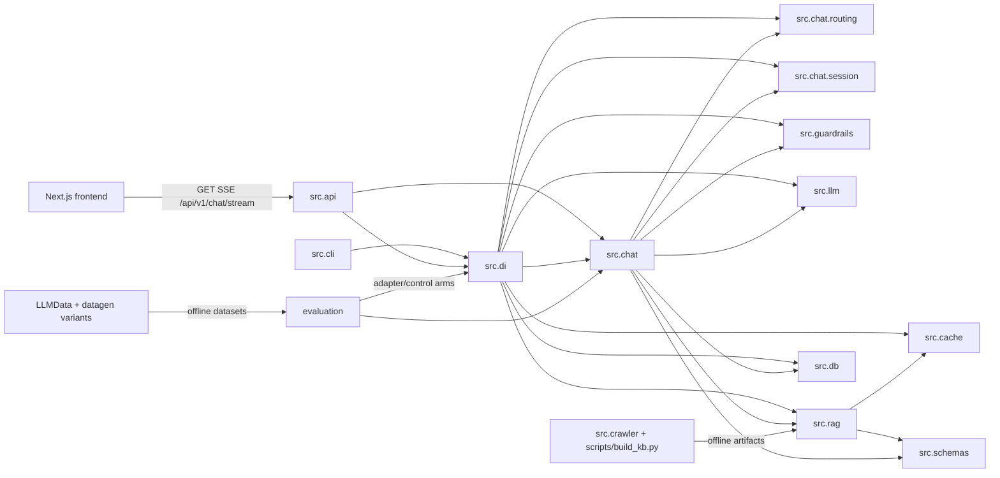

# AcneLLM — truth of architecture

> Historical synthesis of immutable run `20260822T152307Z`. It is preserved
> for provenance. Current runtime truth lives in `CURRENT_TRUTH.md` and
> `../docs/ARCHITECTURE_TRUTH.md`.

## Baseline và mức chứng minh

Tài liệu này được tổng hợp chỉ từ FINDINGS của immutable run
`20260822T152307Z`; không đọc lại live source trong Bước 5.

- Phạm vi vật lý: 783 path = 773 tracked + 10 untracked không bị ignore,
  ngoài `.audit/**`.
- 581 file text/code/config/doc được snapshot và semantic-scan; 202 artifact
  binary/data/runtime được `[skip]` với lý do riêng.
- Semantic surface: 10.403 block, 83.224/83.224 mục 1–8 đã điền, 0 hash mismatch.
- Working tree không sạch tại thời điểm capture. Vì vậy commit SHA một mình
  không tái tạo đủ baseline; `manifest.jsonl`, `git-status.txt`, và snapshot là
  bộ định danh đầy đủ.
- Code là nguồn thắng. Test là bằng chứng hạng hai. Comment/doc chỉ là claim;
  claim chưa đối chiếu được vẫn mang `chưa rõ`, không được biến thành fact.

## Kết luận kiến trúc ngắn

AcneLLM không phải một pipeline duy nhất. Repo chứa bốn hệ có vòng đời khác nhau:

1. **Runtime phục vụ người dùng**: FastAPI + Next.js, local Ollama, intake/routing,
   hybrid RAG, SSE, SQLite session/audit.
2. **KB factory**: crawler/clean/chunk/embed/BM25 tạo artifact mà runtime chỉ đọc.
3. **Data factories**: `LLMData`, `datagen`, `roledata`, `roledatav2`,
   `intakedata`; đây là offline research, không nằm trên request path.
4. **Evaluation harness**: dataset/oracle, adapters, runners, judges, metrics và
   report artifacts; gọi một phần runtime nhưng có control flow và persistence
   riêng.

`src/acne_llm/di.py:88` là composition root thật. `src/acne_llm/api/app.py:23`
là lifecycle root HTTP. `src/acne_llm/chat/orchestrator.py:47` là preparation
root dùng chung. `src/acne_llm/chat/runtime.py:58` là user-visible streaming
root. Không module docs nào được phép thay bốn điểm neo này.

## Biên module production

| Module | Trách nhiệm thật | Không sở hữu |
|---|---|---|
| `src.config` | Pydantic settings, env/default và đường dẫn artifact | Không dựng dependency |
| `src.schemas` | DTO/Pydantic/dataclass đi qua chat, RAG và research | Không quyết định routing |
| `src.cache` | DiskCache cho embedding/retrieval, lỗi cache degrade im lặng | Không invalidate khi rebuild KB |
| `src.chat.routing` | rule/semantic/LLM routing, normalization và extraction adapters | Không sinh câu trả lời |
| `src.chat.session` | chọn history, fold fact, snapshot/confirmed profile | Không sở hữu SQLite connection |
| `src.guardrails` | deterministic pre-check và medication/PII safety helpers | Không sở hữu soft OOS |
| `src.rag` | clean/chunk/embed/vector/BM25/hybrid retrieval/rerank | Không quyết định có retrieve hay không |
| `src.llm` | Ollama HTTP client, language cleanup, Jinja prompt builder | Không sở hữu route/session |
| `src.db` | SQLite connection, session store, audit/feedback persistence | Không điều phối request |
| `src.chat` | intake, mode resolution, retrieval policy, prompt preparation, SSE generation/persistence | Không dựng concrete dependencies |
| `src.di` | Dựng và degrade toàn bộ concrete graph | Không xử lý HTTP request |
| `src.api` | HTTP boundary, auth/rate-limit, validation, streaming response, debug/admin/KB routes | Không chứa clinical policy gốc |
| `src.cli` | Ba entrypoint `chat`, `stats`, `serve` | Không có runtime riêng |
| `src.crawler` | Discovery/fetch/extract/normalize/dedup/quality/stats cho KB offline | Không chạy trong chat request |

## Dependency graph thật



Các cạnh import đã đo cho thấy `src.api → src.chat/config/di/utils`,
`src.di → cache/chat/db/guardrails/llm/rag/utils`, và `src.chat →
cache/db/guardrails/llm/schemas/utils`. `tests` import mọi module production;
research chủ yếu đi vào `config`, `schemas`, `rag`, `chat`, và `di`, không phải
chiều ngược lại. Đây là biên quan trọng: production không phụ thuộc research.

## Luồng request end-to-end

### 1. Khởi động

1. FastAPI lifespan cấu hình logging rồi gọi `build_container(settings)`
   (`api/app.py:23-27`).
2. Container luôn dựng SQLite session store, audit store, cache nếu được bật,
   Ollama generator, prompt builder và guardrails (`di.py:88-225`).
3. Intake có hai topology:
   - `intake_mode=unified`: một `UnifiedIntake` đóng cả router và extractor;
   - còn lại: `LLMRouter` và `LLMExtractor` là hai backend tùy config.
4. Embedder chỉ được thử dựng khi semantic-router train file tồn tại hoặc cả
   Chroma và BM25 sẵn sàng (`di.py:235-253`).
5. Semantic router, Chroma/BM25 và reranker đều có nhánh degrade. Reranker hỏng
   vẫn giữ raw retrieval; KB thiếu làm `rag_ready=False`; semantic router hỏng
   rơi về legacy rule route.
6. Shutdown gọi `Container.close()` cho generator, router/extractor backend và
   session store; lỗi close bị nuốt (`di.py:67-85`).

### 2. HTTP → intake

`GET /api/v1/chat/stream` nhận `message`, `session_id`, `mode`, `temperature`.
Boundary chặn message rỗng, quá số ký tự hoặc quá số từ trước khi tạo
`StreamingResponse` (`api/routes/chat.py:17-49`).

`stream_chat_sse` gọi `prepare_chat_turn`, và hàm này gọi `run_intake`:

1. preprocess/light-normalize raw text;
2. lấy session/history;
3. deterministic guardrail pre-check và medication safety;
4. LLM router nếu có, rồi semantic router/rule fallback;
5. sửa route flag/intent theo invariant cứng;
6. chọn history liên quan;
7. LLM extractor nếu cấu hình, nếu không dùng rule extraction;
8. merge confirmed profile và fold fact lịch sử;
9. tính scope, effective mode, safety terms, confidence và snapshot.

`run_intake` trả `IntakeResult`; nó không sinh prose. Những lỗi router/extractor
có fallback riêng, còn message quá dài ném `ValueError` (`chat/intake.py:198`).

### 3. Intake → retrieval → prompt

`prepare_chat_turn` quyết định retrieve dựa trên effective mode, primary intent,
route flags và `rag_ready`; retrieval không tự quyết định policy. Khi retrieve,
nó dùng query đã dựng từ current turn/history, rồi nhận chunks từ hybrid
retriever. Sau đó nó chọn template, dựng safety/confidence hints và gọi
`PromptBuilder.build` với trần context mặc định 6000 ký tự
(`chat/orchestrator.py:47-166`).

Hybrid RAG có hai nguồn:

- dense vector search trong Chroma qua Embedder;
- sparse BM25 index nạp từ pickle/checksum.

Kết quả được merge/rerank/filter rồi chuyển thành `RetrievedChunk`. Score không
có một đơn vị toàn cục: legacy FINDINGS xác nhận nhiều scale cùng sống trong
`RetrievedChunk.score`; consumer phải hiểu provenance, không được so sánh mù.

### 4. Generation → SSE → persistence

`stream_chat_sse` gọi `OllamaBackend.stream_text`, lọc token CJK, gom full text,
gắn safety suffix, phát các SSE event, rồi persist:

- user/assistant turns và snapshot vào SQLite session store;
- audit entry gồm raw/normalized input, output, route/scope, chunks, latency,
  model, PII và metadata;
- PII được mask cho trường audit tương ứng, không thay raw request trước intake.

Refusal có thể kết thúc trước generation. Với generation thường, lỗi được bắt,
log và chuyển thành SSE error path. `generate_prose` là non-streaming sibling
dùng bởi CLI/evaluation; nó gọi `generate_text` rồi normalize prose
(`chat/orchestrator.py:169`). Hai đường dùng chung preparation nhưng phần hậu xử
lý/streaming không hoàn toàn giống nhau.

## API contract thật

Các route con được gắn dưới `/api/v1`; admin router tự mang prefix
`/api/v1/admin` và dependency admin-auth.

| Nhóm | Route |
|---|---|
| Chat | `GET /api/v1/chat/stream`, `GET /api/v1/debug/trace`, `POST /api/v1/chat/feedback` |
| Health | `GET /api/v1/health`, `GET /api/v1/models` |
| KB | `POST /api/v1/kb/retrieve`, `GET /api/v1/kb/stats`, `GET /api/v1/kb/chunk/{chunk_id}`, `POST /api/v1/kb/search` |
| Admin | `GET /api/v1/admin/audit`, `/sessions/stats`, `/feedback`, `/feedback/stats` |
| Process | `GET /`, `GET /metrics` |

`/debug/trace` đi qua preparation production và dừng trước generation; nó không
phải một pipeline intake giả. Admin auth/rate limit có exemption riêng cho root,
metrics và health theo path. Frontend lấy base URL từ
`NEXT_PUBLIC_API_URL` (`frontend/src/config/chatConfig.ts:12`) và hook SSE gọi
chat endpoint; frontend là consumer, không tái hiện routing/clinical logic.

## State và artifact ownership

| State/artifact | Writer | Reader | Failure policy |
|---|---|---|---|
| `sessions.db` | `SQLiteSessionStore` | intake/runtime/admin stats | Không có JSONL production fallback |
| `audit.db` | `AuditStore` | admin/evaluation/reporting | Nếu path chính mở lỗi, DI dùng temp DB |
| DiskCache | `src.cache` | embedding/retrieval wrappers | Mọi lỗi cache degrade về compute thật |
| Chroma directory | `scripts/build_kb.py` embed step | `ChromaStore` | Thiếu/hỏng làm dense/RAG không ready |
| BM25 pickle + checksum | `scripts/build_kb.py` BM25 step | `BM25Index.load` | Cần cùng Chroma để bật hybrid runtime |
| prompts `.j2` | config/repo | `PromptBuilder` | Template/name mismatch có thể lỗi request |
| guardrails/drug YAML | config/repo | `GuardrailRunner` | Dựng trong DI; không phải runtime-mutated state |
| eval reports/cache | evaluation runners/judges | rescore/dashboard/docs | Không phải production truth |
| datagen outputs/checkpoints | datagen variants | finalize/eval/train notebooks | Không phải production session/data |

## KB factory

`src.crawler` cung cấp discovery, HTTP/Playwright fetch, extraction,
normalization, quality, dedup và stats. Các scripts là orchestration layer.
`scripts/build_kb.py` có ba bước độc lập nhưng có thứ tự dữ liệu:

```text
source documents
  -> clean + chunk (`step_chunk`)
  -> embeddings + Chroma (`step_embed`)
  -> BM25 + checksum (`step_bm25`)
  -> DI readiness check
  -> runtime HybridRetriever
```

Runtime không tự rebuild hay invalidate retrieval cache khi KB đổi. Cache tag/TTL
là cơ chế riêng; legacy FINDINGS xác nhận không có caller invalidate khi build.

## Data-generation systems

Các factory sau cùng tồn tại; không nên gọi chung là “datagen” trong thiết kế:

- `research/LLMData`: nhiều generator chuyên biệt (chunk QA, clinical case,
  injection QA) dùng OpenAI-compatible clients và writer riêng.
- `research/datagen` core: generator/gates/writer/config và CLI tổng.
- `research/datagen/roledata`: pipeline v1 với resume, gate, finalize/export/split.
- `research/datagen/roledatav2`: pipeline v2 nhiều phase, anchor/coverage/finalize
  và probe/show tools; đây là nhánh lớn riêng, không phải wrapper mỏng của v1.
- `research/datagen/intakedata`: generator/gates/pipeline/writer cho contract
  intake, được eval intake tiêu thụ.

Mỗi nhánh có output, checkpoint, rejection/audit và provenance riêng. Không được
trộn row count giữa nhánh, không dùng report artifact để suy ra runtime behavior.

## Evaluation architecture

`research/evaluation/full_evaluation.py` là process orchestrator, không phải một
metric: nó preflight, chọn/skip step, kiểm API key/cost, chạy subprocess và ghi
summary. Các runner thật:

- `run_intake`: load dataset/train, enforce no-overlap, gọi model infer, tính
  metrics và report.
- `run_retrieval`: dựng repo adapter/RAG, chạy retrieval cases và judge/scoring.
- `run_ablation`: dataset-scoped paired arms, fingerprint question/dataset,
  bắt buộc baseline tương thích trước các arm phụ, lưu rows/summary.
- `rescore`: đọc answer rows đã có, chạy judge song song và sinh summary mới.

`adapters/_repo.py` là cầu vào runtime. `judges` sở hữu provider/client/cache và
prompt chấm. `metrics` là pure-ish aggregation. `datasets` sở hữu generation,
oracle và contamination gates. `reports/**` chỉ là output của các runner; audit
đã capture một số JSON untracked để giữ đúng dirty snapshot nhưng chúng không
được nâng thành kiến trúc.

## Invariant toàn cục

1. Production không import research/evaluation/datagen.
2. `build_container(settings)` là nơi duy nhất được phép chọn concrete backend
   production; API/CLI không dựng RAG/LLM/DB bằng tay.
3. Raw user message vẫn là đầu vào authority; normalized/extracted fields là
   evidence cho routing/fold, không được tự biến thành fact nếu confidence/gate
   không đạt.
4. Hard safety có thể chặn flow; soft OOS thuộc router/intake, không thuộc
   `GuardrailRunner`.
5. Retrieval chỉ chạy khi policy của chat cho phép và container `rag_ready`.
6. Hybrid readiness cần cả Chroma và BM25; reranker là optional enhancement.
7. Streaming và non-streaming dùng chung `prepare_chat_turn`; mọi eval claim về
   parity phải tính riêng hậu xử lý stream, suffix và persistence.
8. Session history và audit log là hai SQLite concern khác nhau; không được coi
   audit DB là session store.
9. Eval/ablation artifact phải giữ dataset/question fingerprint và baseline arm;
   report thiếu các gate đó chỉ là directional evidence.
10. Generated data/report/notebook không được coi là runtime source-of-truth.
11. Một cache key phải mang đủ model/query/parameter lineage; code hiện giao một
   phần invariant này cho caller.
12. Snapshot run, không chỉ Git commit, là baseline của audit dirty worktree này.

## Drift và nợ kiến trúc đã xác nhận

Các điểm dưới đây có code evidence trong legacy FINDINGS và chưa được audit này
sửa:

- runtime SSE và evaluation non-streaming còn khác ở normalize/safety suffix;
- có nhiều implementation bỏ dấu/clean text, trong đó bản `_no_accent` cũ từng
  bỏ sót `đ` và regex negation bắt nhầm một số từ Việt;
- retrieval score mang nhiều thang nghĩa; metadata có chỗ bị mutate tại chỗ;
- BM25 build không khóa invariant `len(chunk_ids) == len(texts)`;
- cache retrieval không được invalidate tự động khi rebuild KB;
- một số public schema/export/helper không có caller hoặc thuộc contract tương
  lai nhưng chưa được đánh dấu rõ;
- comment/doc mô tả “cổng duy nhất”, “hai tầng fuzzy”, đường cleaning hoặc số
  lượt history có chỗ lệch code;
- unified intake có các field/nhánh legacy không còn được populate nhưng vẫn
  xuất hiện trong audit/analytics contract;
- API log filename và một số docs/path còn mang tên từ kiến trúc cũ.

Danh sách hành động, bằng chứng Q-id và phân rổ A/B/C nằm ở `todo.md`; tài liệu
này không biến recommendation thành fact.

## Chưa rõ còn lại

- Static caller graph không chứng minh dynamic import/reflection; symbol “0 caller”
  là candidate, không tự động là dead code.
- 11 notebook chứa Jupyter magic/shell nên AST toàn-notebook không parse trọn;
  audit giữ file/cell inventory và parse error thay vì đoán semantics của cell.
- Comment/doc claims ngoài production core được inventory đầy đủ nhưng chưa có
  đủ bằng chứng để đánh `confirmed`; chúng không được dùng làm cạnh kiến trúc.
- Runtime health, model availability, KB row count và chất lượng answer không
  được chạy trong audit read-only này; kiến trúc không đồng nghĩa readiness.
- Dirty evaluation/report artifacts có thể đang thuộc một run dở; trạng thái
  artifact không cho phép kết luận thí nghiệm hoàn tất.

baseline_snapshot_run = 20260822T152307Z
baseline_commit = 585333cc68d6e29b666337bdf366c99e00abc9b7
