# AcneLLM — End-to-End System Architecture

> **Hệ thống tư vấn da mụn tiếng Việt sử dụng Local RAG + Fine-tuned LLM**
> Version: 2026-08-09 · Branch: `codex/simplify-chat-pipeline`

---

## 1. Tổng quan hệ thống

AcneLLM là hệ thống chatbot tư vấn da mụn (acne) toàn diện bằng tiếng Việt, kết hợp:

- **Fine-tuned LLM** (Qwen2.5-7B generator + Qwen2.5-3B intaker) chạy local qua Ollama
- **Hybrid RAG** (Dense Embedding + BM25 Sparse + Cross-Encoder Reranker)
- **Multi-layer Safety Guardrails** (prompt injection, drug interaction, pregnancy contraindication)
- **Next.js Frontend** với streaming SSE/WebSocket
- **Docker Compose** deployment stack (Ollama → Backend → Frontend → Nginx Gateway)

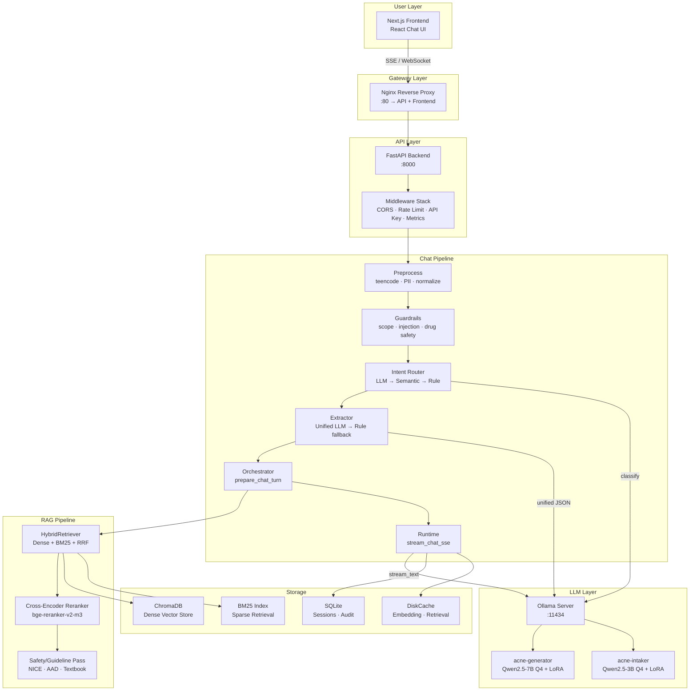

---

## 2. Kiến trúc thư mục

```
AcneLLM/
├── src/acne_llm/           # Backend Python package
│   ├── api/                # FastAPI app, routes, middleware
│   │   ├── app.py          # FastAPI lifespan, middleware stack
│   │   ├── routes/         # chat, kb, health, admin, metrics
│   │   ├── observability.py # API Key, Rate Limit, Request Logging
│   │   ├── static/         # Pipeline simulator HTML
│   │   └── templates/      # Debug trace templates
│   ├── chat/               # ★ Chat pipeline core
│   │   ├── orchestrator.py # prepare_chat_turn — single entry point
│   │   ├── runtime.py      # stream_chat_sse — SSE streaming
│   │   ├── intake.py       # Pre-LLM intake: preprocess → guard → route → extract
│   │   ├── unified_intake.py # One-model adapter: route + extract in 1 call
│   │   ├── _retrieval.py   # Multi-pass retrieve + rerank + filters
│   │   ├── _safety.py      # Post-generation safety suffix
│   │   ├── _intake_parse.py # JSON parser cho unified intake output
│   │   ├── _intent_patch.py # Data-driven intent repair
│   │   ├── _terms.py       # Clinical terminology constants
│   │   ├── confidence_hint.py # Low-confidence field → hedge prompt
│   │   ├── preprocess.py   # Text cleaning, teencode, accents
│   │   ├── session.py      # Conversation session + history fold
│   │   └── fallback/       # Fallback implementations
│   │       ├── intent_router.py   # Rule-based intent routing
│   │       ├── semantic_router.py # KNN semantic intent router
│   │       ├── llm_router.py      # Legacy LLM router (separate model)
│   │       ├── llm_extractor.py   # Legacy LLM extractor (separate model)
│   │       ├── rule_normalizer.py # Rule-based field extraction (78KB)
│   │       └── rule_extractor.py  # Confidence-aware rule extractor
│   ├── llm/                # LLM abstraction
│   │   ├── ollama_backend.py # Ollama HTTP client (generate + stream)
│   │   ├── prompt_builder.py # Jinja2 template rendering + sanitization
│   │   ├── qa_generator.py   # QA pair generation for finetune
│   │   └── language.py        # Language detection
│   ├── rag/                # RAG components
│   │   ├── retriever.py    # HybridRetriever: dense + BM25 + RRF + MMR
│   │   ├── reranker.py     # Cross-Encoder reranker (bge-reranker-v2-m3)
│   │   ├── embedder.py     # Vietnamese Embedding model
│   │   ├── vectorstore.py  # ChromaDB wrapper
│   │   ├── sparse.py       # BM25 index
│   │   ├── chunker.py      # Document chunker
│   │   └── cleaning.py     # Text cleaning for indexing
│   ├── guardrails/         # Safety layer
│   │   ├── runner.py       # GuardrailRunner: pre/post check + scope + drug
│   │   ├── drug_checker.py # Medication interaction checker
│   │   └── ood_detector.py # Out-of-domain detector + PII masking
│   ├── schemas/            # Pydantic data models
│   │   ├── core.py         # UserInput, AdviseOutput, RetrievedChunk
│   │   ├── extraction.py   # ExtractionConfidence, FieldResult
│   │   ├── clinical.py     # AcneClinicalInput
│   │   └── kb.py           # KB metadata, source_type inference
│   ├── crawler/            # Web crawler for KB data
│   │   ├── discovery.py    # URL discovery + sitemap parsing
│   │   ├── fetcher.py      # HTTP fetcher + rate limiting
│   │   ├── playwright_fetcher.py # JS-rendered page fetcher
│   │   ├── quality_filter.py # Content quality scoring
│   │   ├── dedup.py        # Near-duplicate detection
│   │   ├── checkpoint.py   # Crawl resume checkpoints
│   │   └── stats.py        # Crawl statistics
│   ├── db/                 # Database layer
│   │   ├── session_store.py # SQLite session store
│   │   ├── audit.py        # Audit log store
│   │   └── base.py         # DB connection wrapper
│   ├── utils/              # Shared utilities
│   │   ├── chunk_filter.py # Post-retrieval chunk filtering
│   │   ├── retrieval_query.py # Query construction
│   │   ├── logging.py      # Structured logging + runtime banner
│   │   ├── text_cleaning.py # Vietnamese text normalization
│   │   └── fuzzy_match.py  # Fuzzy string matching
│   ├── config.py           # Pydantic Settings (single source of truth)
│   ├── di.py               # Dependency Injection container
│   ├── cache.py            # DiskCache for embeddings & retrieval
│   └── cli.py              # CLI entry point
├── frontend/               # Next.js chat UI
│   └── src/
│       ├── components/chat/ # ChatWindow, MessageBubble, SourceCard, etc.
│       ├── config/          # Chat configuration
│       ├── hooks/           # React hooks
│       ├── stores/          # State management
│       └── lib/             # Utility functions
├── config/                 # Runtime configuration
│   ├── prompts/            # Jinja2 prompt templates
│   │   ├── stream_user.j2  # Advise prompt (main)
│   │   ├── knowledge_user.j2 # Knowledge query prompt
│   │   ├── clarify_user.j2 # Clarification prompt
│   │   ├── reject_user.j2  # Out-of-scope rejection
│   │   └── refuse_user.j2  # Safety refusal
│   ├── guardrails.yaml     # Guardrail rules
│   └── drugs_acne.yaml     # Drug interaction database
├── model/                  # Ollama model artifacts
│   ├── generator/          # acne-generator (Qwen2.5-7B + LoRA)
│   │   ├── Qwen2.5-7B-Instruct.Q4_K_M.gguf  # Base model (4.7GB)
│   │   ├── acnellm-role.Q4_K_M.gguf          # LoRA adapter
│   │   ├── Modelfile.full   # Full Modelfile with SYSTEM prompt
│   │   └── Modelfile.simplify # Simplified Modelfile
│   └── intaker/            # acne-intaker (Qwen2.5-3B + LoRA)
│       ├── Qwen2.5-3B-Instruct.Q4_K_M.gguf   # Base model (1.9GB)
│       ├── qwen25_intake_lora.zip              # LoRA adapter
│       └── Modelfile        # Intaker Modelfile
├── data/                   # Runtime data
│   ├── seed_sources.yaml   # Crawler source definitions
│   ├── chroma_db/          # ChromaDB vector store
│   ├── bm25_index.pkl      # BM25 sparse index
│   ├── intent_classify.train.jsonl  # Semantic router training data
│   ├── raw/                # Raw documents + chunks (JSONL)
│   └── finetune/           # Fine-tuning datasets
├── datagen/                # Fine-tuning data generation pipeline
│   ├── main.py             # Multi-stage datagen orchestrator
│   ├── generator.py        # Clinical case + QA generator
│   ├── gates.py            # Quality gates for generated data
│   ├── intakedata/         # Intaker training data pipeline
│   └── roledata/           # Generator role-play data pipeline
├── evaluation/             # Evaluation framework
│   ├── full_evaluation.py  # End-to-end evaluation orchestrator
│   ├── runners/            # Intake, Retrieval, Ablation runners
│   ├── judges/             # LLM-as-Judge (DeepSeek/OpenAI/Anthropic)
│   ├── metrics/            # Classification, deterministic, scorecard
│   ├── datasets/           # Eval datasets (v3.x JSONL)
│   └── e2e.ps1             # PowerShell E2E eval launcher
├── scripts/                # Build & utility scripts
│   ├── build_kb.py         # Knowledge Base build pipeline
│   ├── crawl_all.py        # Full crawl orchestrator
│   ├── RUN.ps1             # Development server launcher
│   └── KB.ps1              # KB build PowerShell wrapper
├── notebooks/              # Jupyter notebooks
│   ├── generator/          # Generator fine-tuning notebooks
│   └── intaker/            # Intaker fine-tuning notebooks
├── visualization/          # Architecture & data visualizations
│   ├── KB/                 # Knowledge Base analytics charts
│   ├── evaluation/         # Evaluation result charts
│   ├── finetune_generator/ # Generator fine-tuning analytics
│   ├── finetune_intaker/   # Intaker fine-tuning analytics
│   ├── repository/         # Codebase structure charts
│   ├── workflow/           # Pipeline workflow diagrams
│   └── index.html          # Visualization gallery
├── docker/                 # Docker support files
│   ├── nginx/              # Nginx reverse proxy config
│   └── ollama-init.sh      # Ollama model initialization
├── docker-compose.yml      # Full stack deployment
├── docker-compose.gpu.yml  # GPU override
├── Dockerfile              # Backend container
└── tests/                  # 40+ test files
    ├── test_chat_stream.py # Integration tests for chat pipeline
    ├── test_intake.py      # Intake pipeline tests
    ├── test_guardrails.py  # Safety guardrail tests
    └── ...
```

---

## 3. Chat Pipeline — Luồng xử lý chính

### 3.1 Tổng quan luồng (End-to-End Request Flow)

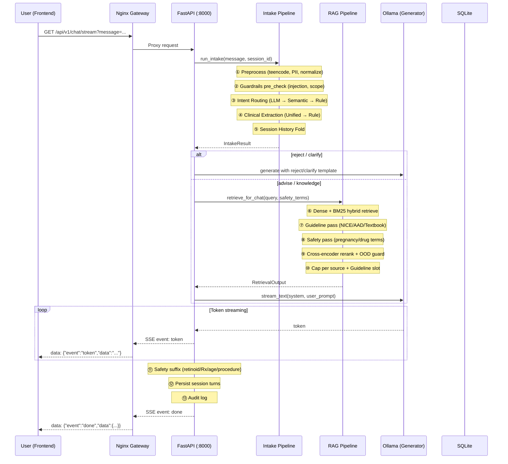

### 3.2 Stage 1: Preprocess (`chat/preprocess.py`)

| Step | Action | Details |
|------|--------|---------|
| 1 | Teencode normalization | `k` → `không`, `dc` → `được`, etc. |
| 2 | Unicode normalization | NFC normalization |
| 3 | Accent stripping | Tạo bản không dấu cho matching |
| 4 | PII detection | Phone, email, CMND/CCCD patterns |
| 5 | Length validation | Max 4000 chars, 500 words |

### 3.3 Stage 2: Guardrails (`guardrails/runner.py`)

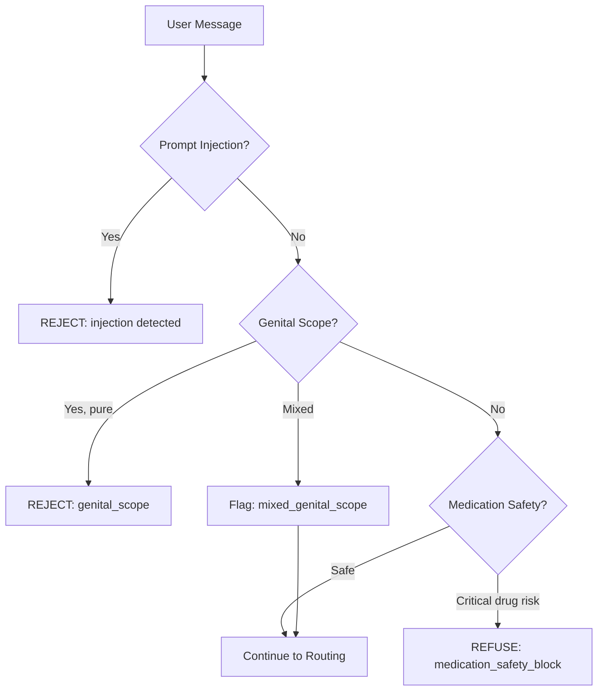

**Pre-check layers:**
1. **Prompt injection detection**: 60+ phrases (EN + VI + teencode) — hard reject
2. **Genital scope**: Hard reject nếu mention vùng sinh dục (trừ mixed acne context)
3. **Medication safety**: Pregnancy + retinoid/tetracycline → immediate refusal
4. **Acne scope check**: Keyword + Embedding OOD detection

### 3.4 Stage 3: Intent Routing (3-tier cascade)

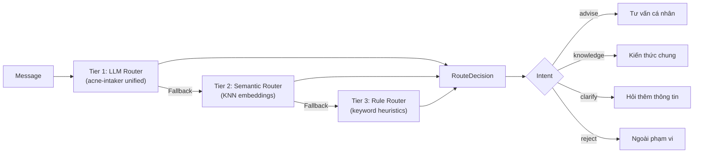

| Router | Model | Latency | Accuracy | Fallback |
|--------|-------|---------|----------|----------|
| **Unified LLM** | acne-intaker (3B Q4) | ~200ms | Highest | → Semantic |
| **Semantic** | KNN over embeddings | ~5ms | High | → Rule |
| **Rule** | Keyword heuristics | <1ms | Moderate | Terminal |

**Route flags** (computed from text, router-independent):
- `urgency_red_flag` — dấu hiệu khẩn cấp
- `crisis_signal` — căng thẳng tâm lý
- `progress_followup` — theo dõi điều trị
- `multi_condition` — nhiều tình trạng da
- `mixed_genital_scope` — vùng da hỗn hợp

### 3.5 Stage 4: Clinical Extraction

**Unified Intake** (production default):
- 1 inference call → returns both `intent` + `clinical fields` as JSON
- Model: `acne-intaker` (Qwen2.5-3B fine-tuned)
- JSON contract: `{intent, confidence, description, context, clinical}`
- Temperature: 0.0 (deterministic extraction)

**Extracted fields:**

| Category | Fields |
|----------|--------|
| **Context** | age, sex, skin_type, is_pregnant, is_breastfeeding, duration_weeks, allergies, current_products, medications |
| **Clinical** | lesion_types, inflammation_level (IGA scale), lesion_distribution |
| **Confidence** | Per-field confidence `{value, confidence, method}` |

**Fallback chain:**
```
UnifiedIntake (3B LLM) → LLMExtractor (1.5B) → Rule Normalizer (regex/keyword)
```

### 3.6 Stage 5: Session Management (`chat/session.py`)

- **SQLite-backed** session store (`data/sessions.db`)
- **History window**: Last 6 turns (configurable `HISTORY_WINDOW_TURNS`)
- **Session TTL**: 1800s (30 minutes idle)
- **History fold**: Merge extracted facts across turns into unified `UserInput`
- **Confirmed profile**: Persistent user context (age, medications, allergies) across session
- **Turn snapshot**: Freeze normalized data per advise turn

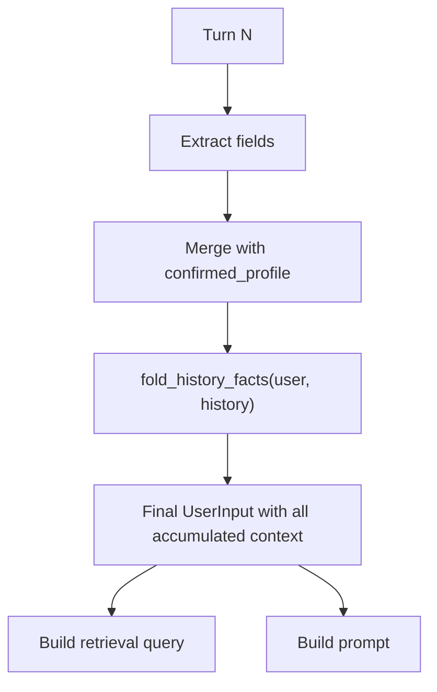

### 3.7 Stage 6-10: RAG Pipeline (`chat/_retrieval.py`)

#### Retrieval Architecture

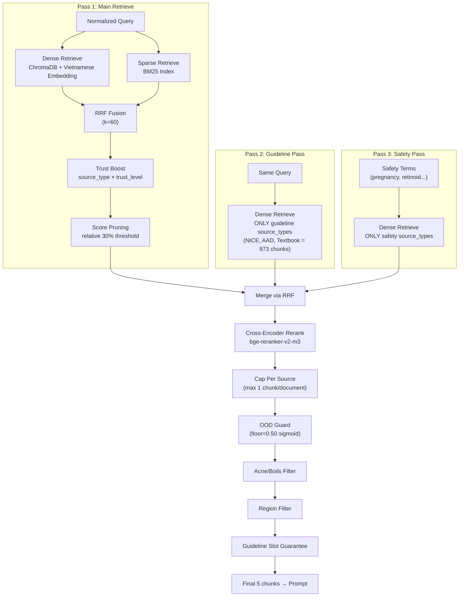

#### Source Type Boost Values

| Source Type | Boost | Examples |
|-------------|-------|---------|
| `nice_guideline` | 1.60× | NICE acne guidelines |
| `aad_guideline` | 1.60× | AAD clinical recommendations |
| `clinical_textbook` | 1.50× | EuroGuiDerm, BYT, JDA, CMAJ |
| `jid_paper` | 1.30× | Journal of Investigative Dermatology |
| `pubmed_review` | 1.20× | PubMed review articles |
| `vi_medical_site` | 1.00× | Vietnamese health websites |
| `forum_post` | 0.80× | Health forums |
| `blog` | 0.70× | Health blogs |

#### Key Retrieval Parameters

| Parameter | Value | Description |
|-----------|-------|-------------|
| `chat_retrieve_top_k` | 25 | Candidates into reranker pool |
| `chat_rerank_top_k` | 5 | Final chunks for prompt |
| `chat_rerank_floor` | 0.50 | OOD guard sigmoid threshold |
| `chat_max_chunks_per_source` | 1 | Diversity: 1 chunk per document |
| `chat_max_context_chars` | 6000 | Max context injected into prompt |
| `chat_guideline_top_k` | 5 | Guideline pass candidates |
| `chat_safety_top_k` | 5 | Safety pass candidates |
| `dense_max_distance` | 0.60 | Chroma cosine distance filter |
| `reranker_min_sigmoid` | 0.30 | Reranker per-chunk floor |

### 3.8 Stage 11: Prompt Building (`llm/prompt_builder.py`)

**Template selection logic:**

```python
if scope_refusal:         template = "refuse_user.j2"
elif intent == "reject":  template = "reject_user.j2"
elif intent == "clarify": template = "clarify_user.j2"
elif intent == "knowledge": template = "knowledge_user.j2"
else:                     template = "stream_user.j2"  # advise
```

**Prompt structure** (stream_user.j2):
```
[Tài liệu tham khảo]  ← retrieved context with source badges
---
[Lịch sử hội thoại]   ← sanitized recent turns
---
[Dữ kiện an toàn]      ← confirmed safety facts (pregnancy, meds)
---
[Tin nhắn hiện tại]    ← sanitized user message
[Gợi ý confidence]     ← low-confidence field hedges
```

**Security layers in prompt:**
1. Jinja2 delimiter escaping (`{{` → `{ {`)
2. Injection marker neutralization (60+ patterns)
3. HTML tag stripping from chunk text
4. Control character removal
5. Source badge labeling for evidence hierarchy

### 3.9 Stage 12: LLM Generation

**Generator model**: `acne-generator` (Qwen2.5-7B-Instruct Q4_K_M + LoRA)

| Parameter | Value | Rationale |
|-----------|-------|-----------|
| `num_ctx` | 8192 | Context window |
| `num_predict` | 2048 | Max output tokens |
| `temperature` | 0.35 | Low for factual generation |
| `top_p` | 0.85 | Nucleus sampling |
| `top_k` | 40 | Top-K sampling |
| `repeat_penalty` | 1.1 | Repetition control |
| `keep_alive` | -1 | Keep model warm in VRAM |
| `use_modelfile_system` | true | System prompt embedded in Modelfile |

**Streaming flow:**
1. `stream_text()` yields tokens via Ollama `/api/generate` (streaming)
2. Per-token CJK character stripping (guard against hallucinated Chinese)
3. Crisis signal → prepend empathy prefix before generation
4. Knowledge intent → no hard cap on output length

### 3.10 Stage 13: Safety Suffix (`chat/_safety.py`)

**Post-generation safety checks (appended after LLM output):**

| Check | Condition | Suffix |
|-------|-----------|--------|
| **Retinoid + Pregnancy** | Positively mentions retinoid AND user is pregnant/breastfeeding | ⚠️ Chống chỉ định retinoid |
| **Retinoid + Unknown Sex** | Mentions retinoid, sex unknown | ⚠️ Precautionary retinoid warning |
| **Rx Drug Advice** | Positively recommends prescription drugs | ⚠️ Thuốc kê đơn cần bác sĩ |
| **Age < 12** | User age under 12 | ⚠️ Da liễu nhi |
| **Urgency Red Flag** | Emergency route flags | 🚨 Đến cơ sở y tế |
| **Multi-condition** | Rosacea/eczema comorbidity | ⚠️ Khám chuyên khoa |
| **Self-procedure** | Mentions self-extraction tools | ⚠️ Không tự nặn/chích |
| **Generic Disclaimer** | Long response without existing disclaimer | Tham khảo bác sĩ da liễu |

**Deduplication**: Each suffix checks `_already_has_warning()` to avoid duplicate disclaimers.

---

## 4. LLM Models

### 4.1 Model Architecture

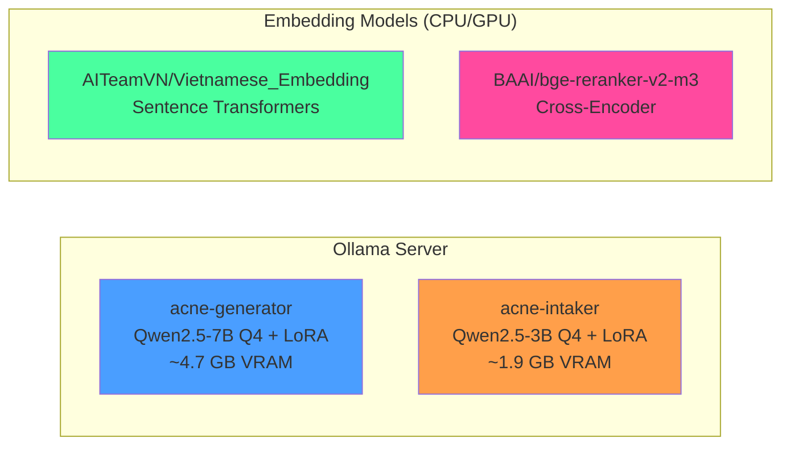

### 4.2 Fine-tuning Data Pipeline (`datagen/`)

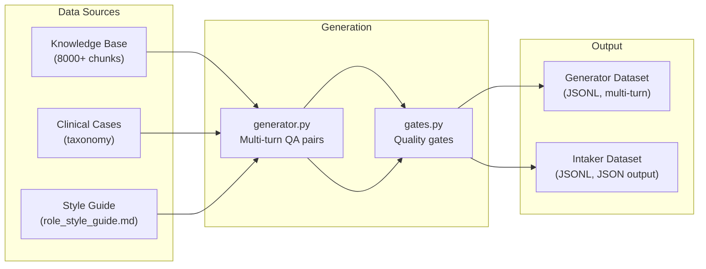

**Quality gates** (41KB of validation logic):
- Format validation (JSON schema)
- Content safety checks
- Contamination detection (test set leakage)
- Role adherence scoring
- Vietnamese language quality

---

## 5. Knowledge Base Pipeline

### 5.1 Data Flow

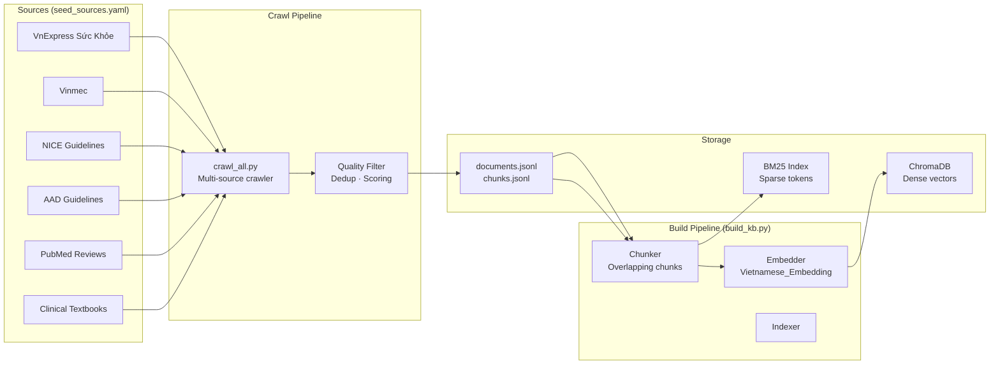

### 5.2 Key Parameters

| Component | Setting | Value |
|-----------|---------|-------|
| Embedding | Model | `AITeamVN/Vietnamese_Embedding` |
| Embedding | Device | CPU (default) or CUDA |
| Chunker | Strategy | Overlapping with 40-token overlap |
| ChromaDB | Distance | Cosine |
| BM25 | Index | Pickle-serialized |
| Crawl | Concurrency | 8 |
| Crawl | Rate limit | 1.0 req/sec/domain |
| Sources | Total | 874 lines in seed_sources.yaml |

---

## 6. Guardrails & Safety System

### 6.1 Multi-layer Safety Architecture

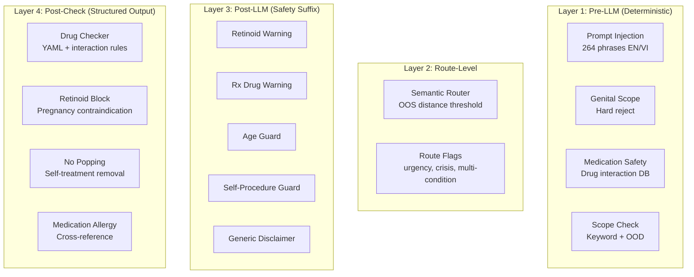

### 6.2 Drug Interaction Checker

- **Source**: `config/drugs_acne.yaml` (9.5KB)
- **Rules**: Pregnancy categories, interaction pairs, dosage limits
- **Critical checks**:
  - Isotretinoin + Pregnancy → ABSOLUTE contraindication
  - Isotretinoin + Tetracycline → Intracranial pressure risk
  - Retinoid + Breastfeeding → Teratogenicity risk

---

## 7. API Layer

### 7.1 Route Map

| Method | Path | Handler | Description |
|--------|------|---------|-------------|
| `GET` | `/api/v1/chat/stream` | `chat_stream` | SSE streaming chat |
| `WS` | `/ws/chat` | `chat_ws` | WebSocket chat |
| `POST` | `/api/v1/chat/feedback` | `submit_feedback` | Thumbs up/down |
| `GET` | `/api/v1/debug/trace` | `debug_trace` | Full pipeline trace |
| `GET` | `/api/v1/health` | `health_check` | System health |
| `GET` | `/api/v1/kb/stats` | `kb_stats` | KB statistics |
| `GET` | `/metrics` | `metrics` | Prometheus-style metrics |

### 7.2 Middleware Stack (order matters)

```
Request → RateLimitMiddleware → APIKeyMiddleware → RequestLoggingMiddleware → CORS → Route Handler
```

| Middleware | Function |
|-----------|----------|
| `CORSMiddleware` | Whitelist origins (no wildcard) |
| `RateLimitMiddleware` | 60 req/min per IP |
| `APIKeyMiddleware` | Optional API key auth |
| `RequestLoggingMiddleware` | Request/response logging + metrics |

### 7.3 SSE Event Protocol

```json
// Token streaming
{"event": "token", "data": "Mụn viêm ..."}

// Source citation
{"event": "source", "data": {"chunk_id": "...", "source": "NICE", "score": 0.95, "text": "..."}}

// Completion
{"event": "done", "data": {
    "mode": "hybrid",
    "latency_ms": 2340,
    "used_chunks": ["chunk_1", "chunk_2"],
    "session_id": "abc123",
    "evidence_quality": "strong",
    "primary_intent": "advise",
    "route_flags": ["urgency_red_flag"]
}}

// Error
{"event": "error", "data": "Đã xảy ra lỗi, vui lòng thử lại."}
```

---

## 8. Frontend Architecture

### 8.1 Technology Stack

- **Framework**: Next.js (React)
- **Transport**: SSE (EventSource) primary, WebSocket fallback
- **State**: Zustand stores
- **Styling**: CSS Modules

### 8.2 Component Structure

```
ChatWindow.tsx          ← Main chat container
├── MessageInput.tsx    ← Input field + send button
├── MessageBubble.tsx   ← User/Assistant message rendering
├── SourceCard.tsx      ← RAG source citation cards
└── ChunkDetailModal.tsx ← Full chunk text viewer
```

### 8.3 Chat Config

```typescript
// frontend/src/config/chatConfig.ts
API_URL: process.env.NEXT_PUBLIC_API_URL || ""
STREAM_ENDPOINT: "/api/v1/chat/stream"
WS_ENDPOINT: "/ws/chat"
```

---

## 9. Deployment Architecture

### 9.1 Docker Compose Stack

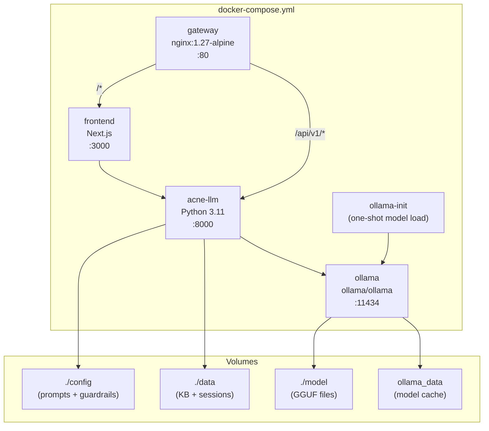

### 9.2 Service Dependencies

```
ollama (healthy) → ollama-init (completed) → acne-llm (healthy) → frontend (healthy) → gateway
```

### 9.3 Health Check

```python
# Backend health check
GET /api/v1/health
→ {"status": "ok", "ollama": true, "bm25_loaded": true, "kb_chunks": 8000+}
```

### 9.4 GPU Support

```yaml
# docker-compose.gpu.yml (override)
services:
  ollama:
    deploy:
      resources:
        reservations:
          devices:
            - capabilities: [gpu]
```

---

## 10. Evaluation Framework

### 10.1 Architecture

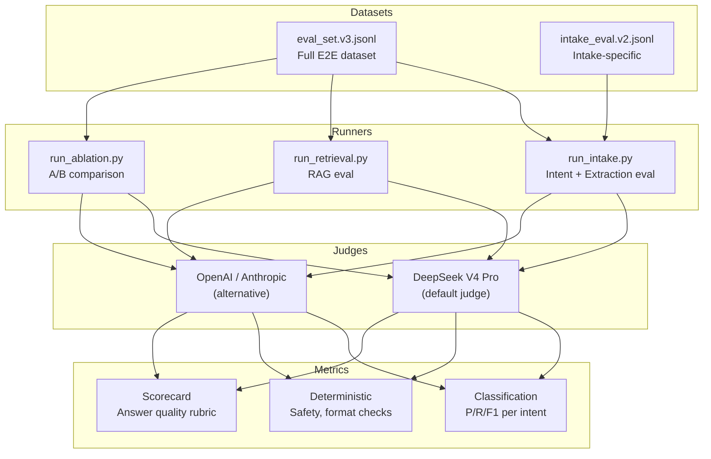

### 10.2 Evaluation Dimensions

| Dimension | Metrics | Source |
|-----------|---------|--------|
| **Intent Classification** | Precision, Recall, F1 per intent | `metrics/classification.py` |
| **Clinical Extraction** | Field-level F1, scalar/list quality | `metrics/intake.py` |
| **Retrieval Quality** | Source type recall, chunk relevance | `runners/run_retrieval.py` |
| **Answer Quality** | 5-point rubric (LLM judge) | `judges/rubrics.py` |
| **Safety Compliance** | Disclaimer presence, drug warning coverage | `metrics/deterministic.py` |
| **Ablation** | A/B comparison across pipeline arms | `runners/run_ablation.py` |

### 10.3 Judge Configuration

```python
# config.py
judge_provider: Literal["openai", "anthropic", "deepseek"] = "deepseek"
judge_model: str = "deepseek-v4-pro"
```

---

## 11. Configuration System

### 11.1 Config Layer Convention

```
Modelfile (model/)     → Artifact-level: FROM, TEMPLATE, SYSTEM, stop tokens
.env                   → Environment-specific: URLs, secrets, paths, feature flags
config.py              → Single source of truth: SCHEMA + DEFAULTS
```

### 11.2 Key Feature Flags

| Flag | Default | Description |
|------|---------|-------------|
| `intake_mode` | `unified` | `unified` = 1 model, `legacy` = separate router+extractor |
| `extractor_mode` | `llm` | `llm` = small model extraction, `rule` = regex only |
| `router_mode` | `llm` | `llm` = generative router, `semantic` = embedding KNN |
| `llm_use_modelfile_system` | `true` | System prompt in Modelfile vs API |
| `guardrails_scope_mode` | `soft` | `hard` = block OOS, `soft` = let LLM decide |
| `device` | `cpu` | `cpu`, `cuda`, `cuda:N`, `mps`, `auto` |

---

## 12. Dependency Injection (`di.py`)

### Container Components

```python
class Container:
    settings: Settings
    llm: OllamaBackend              # Generator (7B)
    prompt: PromptBuilder           # Jinja2 templates
    guardrails: GuardrailRunner     # Safety layer
    vision: MockVision              # Placeholder for future vision
    session_store: SQLiteSessionStore
    audit_store: AuditStore
    embedder: Embedder | None       # Vietnamese embedding
    store: ChromaStore | None       # Dense vector store
    bm25: BM25Index | None          # Sparse index
    retriever: HybridRetriever | None
    reranker: Reranker | None       # Cross-encoder
    llm_extractor: UnifiedIntake | LLMExtractor | None
    llm_router: UnifiedIntake | LLMRouter | None
    semantic_router: SemanticRouter | None
```

**Initialization order**: DB → Cache → LLM → Intake/Router → Prompt → Guardrails → Embedder → SemanticRouter → RAG (Chroma + BM25 + Retriever + Reranker)

---

## 13. Caching Strategy

### 13.1 DiskCache (`cache.py`)

- **Location**: `./data/cache/`
- **Size limit**: 2 GB
- **Cached items**: Embedding vectors, retrieval results
- **Cache key**: `(version, query, top_k, rerank_top_k, min_score, safety_terms)`
- **Version bump**: Required when retrieval logic changes

### 13.2 In-Memory Caches

| Component | Cache | Strategy |
|-----------|-------|----------|
| Reranker | LRU cache (2048 entries) | Query + chunk_id → score |
| UnifiedIntake | Single-entry `(text, history)` | Avoid double inference per turn |
| SemanticRouter | NPZ file | Pre-computed train set embeddings |

---

## 14. Logging & Observability

### 14.1 Structured Pipeline Logging

```
[session_id] STAGE      status=...  key=value  (elapsed_ms)
```

**Stages tracked**: `INPUT` → `PREPROCESS` → `SAFETY` → `ROUTE` → `EXTRACT` → `INTAKE` → `RAG` → `GENERATE` → `OUTPUT`

### 14.2 Audit Trail

Every chat turn → `SQLite audit.db`:
- User message (PII-masked if detected)
- Assistant response
- Used chunk IDs
- Scope decision
- Latency
- Model used
- Normalized query
- Extracted entities

### 14.3 Metrics

- Request count, latency histogram
- Error rate
- Active sessions
- Cache hit rate

---

## 15. Testing Strategy

### 15.1 Test Coverage (40+ files)

| Category | Files | Description |
|----------|-------|-------------|
| **Pipeline Integration** | `test_chat_stream.py` (22KB) | End-to-end chat streaming |
| **Intake** | `test_intake.py` (20KB) | All intake stages |
| **Guardrails** | `test_guardrails.py` (12KB) | Safety rules |
| **Normalizer** | `test_normalizer_regression.py` (16KB) | Rule extraction regression |
| **Router** | `test_intent_router_new.py`, `test_semantic_router.py` | Intent routing |
| **Retrieval** | `test_retriever.py`, `test_retrieval_merge.py` | RAG pipeline |
| **Prompt** | `test_prompt_builder.py` (11KB) | Template rendering + sanitization |
| **Session** | `test_session.py` (13KB), `test_sqlite_session_store.py` | Session management |
| **Safety** | `test_stream_safety.py`, `test_confidence_behavior.py` | Post-gen safety |
| **Schemas** | `test_schemas.py`, `test_extraction_*.py` | Data model validation |

### 15.2 Evaluation Datasets

| Dataset | Size | Purpose |
|---------|------|---------|
| `eval_set.v3.jsonl` | Full E2E | Answer quality + safety compliance |
| `eval_set.v3.1.jsonl` | Variant | Extended scenarios |
| `eval_set.v3.2.jsonl` | Variant | Latest generation |
| `intake_eval.v2.jsonl` | Intake-specific | Intent + extraction accuracy |

---

## 16. Performance Characteristics

### 16.1 Typical Latency Breakdown

| Stage | Typical (ms) | Notes |
|-------|-------------|-------|
| Preprocess | 1-5 | Regex + teencode |
| Guardrails pre_check | 1-3 | Keyword matching |
| Intent routing (LLM) | 150-300 | 3B model inference |
| Clinical extraction | 0 (reused) | Same inference as routing |
| Session fold | 5-15 | SQLite read + merge |
| Dense retrieval | 50-100 | Embedding + Chroma query |
| BM25 retrieval | 10-30 | Sparse lookup |
| Guideline pass | 50-100 | Second Chroma query |
| Cross-encoder rerank | 100-200 | Batch scoring |
| Prompt build | 5-10 | Jinja2 render |
| LLM generation (7B) | 1500-5000 | Token-by-token streaming |
| Safety suffix | 1-5 | Pattern matching |
| **Total** | **~2000-6000** | Dominated by LLM generation |

### 16.2 Resource Requirements

| Resource | Minimum | Recommended |
|----------|---------|-------------|
| VRAM | 6 GB | 8+ GB |
| RAM | 8 GB | 16 GB |
| Disk | 15 GB | 20+ GB |
| CPU | 4 cores | 8 cores |

---

*Document auto-generated: 2026-08-09 | AcneLLM Architecture Report*
